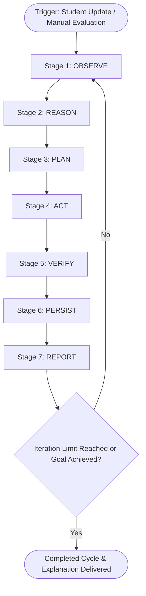

# Agent Workflow & Tool Specifications: CareerAI

## 1. The 7-Stage Autonomous Agent Controller

CareerAI implements a closed-loop agent controller inspired by classic cognitive agent architectures (BDI: Belief-Desire-Intention and OODA loops), tailored specifically for student career guidance.

### Stage 1: OBSERVE
- **Objective**: Retrieve a comprehensive, consistent snapshot of the student's current state.
- **Data Retrieved**:
  - Academic background (degree, branch, GPA, year).
  - Current technical skill assessments (0 to 5 scale).
  - Target career goal and weekly study hours commitment.
  - Active roadmap milestones and statuses (`not_started`, `in_progress`, `completed`, `blocked`).
  - Recent agent observations and progress update timestamps.
- **Database Effect**: Records an `OBSERVE` action log in `agent_action_logs`.

### Stage 2: REASON
- **Objective**: Perform explicit, deterministic evaluation of the observed state against educational benchmarks.
- **Evaluations Executed**:
  - **Skill Gap Math**: `Gap = max(0, Target - Current)`.
  - **Hours Mismatch**: Compares `student.weekly_hours` against `roadmap.weekly_hours`.
  - **Goal Mismatch**: Compares `student.target_role` against `roadmap.target_role`.
  - **Bottleneck Detection**: Flags any milestone marked `blocked` or exceeding expected duration.
  - **Completion Auditing**: Checks whether all milestones are achieved.

### Stage 3: PLAN
- **Objective**: Formulate an ordered list of high-priority corrective or progressive actions.
- **Planning Logic**:
  1. If no roadmap exists → Plan `generate_initial_roadmap`.
  2. If role changed → Plan `revise_roadmap_role` (preserves transferable work).
  3. If hours changed → Plan `revise_roadmap_hours` (rebalances deadlines).
  4. If milestones blocked → Plan `flag_learning_delays`.
  5. Always → Plan `evaluate_next_best_action`.

### Stage 4: ACT
- **Objective**: Safely execute the chosen agent tools with strongly typed inputs.
- **Execution Rule**: The agent invokes only the specific tools demanded by the reasoned plan rather than blindly executing all tools.

### Stage 5: VERIFY
- **Objective**: Inspect the outputs of executed actions before finalizing changes.
- **Verification Criteria**:
  - Schema integrity: All required milestone fields are present and valid.
  - Dependency order: Prerequisite milestones precede downstream milestones.
  - Preservation check: Completed milestones are intact and never reset to `not_started`.
  - Anti-duplication: No duplicate milestones created.

### Stage 6: PERSIST
- **Objective**: Commit state changes and decision records to the SQLite database.
- **Records Written**:
  - Updates to `roadmaps` and `roadmap_milestones`.
  - New record in `agent_observations`.
  - New audit entries in `agent_action_logs`.
  - If revision occurred: new record in `roadmap_revision_history`.

### Stage 7: REPORT
- **Objective**: Generate a clear, structured decision explanation for the student.
- **Report Structure**:
  - **What Was Detected**: Specific factors discovered during reasoning.
  - **Actions Taken**: Clear summary of what was revised or recommended.
  - **Why CareerAI Recommended This**: Simple English explanation of the pedagogical rationale.
  - **Next Best Action**: The single highest-priority learning activity to undertake next.

---

## 2. Specification of the 12 Required Agent Tools

| # | Tool Name | Description | Key Inputs | Key Outputs |
|---|---|---|---|---|
| 1 | `get_student_profile` | Retrieves student profile & skills | `student_id: int` | Dict containing student profile & skill assessments |
| 2 | `get_career_requirements` | Retrieves role requirements | `role_title_or_slug: str` | Dict containing role requirements & activities |
| 3 | `analyze_skill_gaps` | Calculates deterministic skill gaps | `student_id: int`, `target_role: str` | Match percentage, list of skill gaps with priorities |
| 4 | `generate_career_roadmap` | Generates phased milestone roadmap | `student_id: int`, `target_role: str`, `weekly_hours: float` | Phased roadmap object with sequenced milestones |
| 5 | `recommend_learning_resources` | Returns verified learning resources | `skills: list[str]` | List of verified documentation and tutorial links |
| 6 | `recommend_projects` | Matches industry portfolio projects | `skills: list[str]`, `target_role: str` | Project details, deliverables, verification checklist |
| 7 | `update_milestone_progress` | Updates status & logs update | `milestone_id: int`, `new_status: str`, `notes: str` | Updated milestone record & timestamp |
| 8 | `detect_learning_delays` | Detects blocked or overdue items | `student_id: int` | List of detected delay alerts with severity |
| 9 | `revise_career_roadmap` | Revises roadmap with preservation | `student_id: int`, `trigger_reason: str`, `new_hours`, `new_role` | Revision summary and count of preserved milestones |
| 10 | `save_agent_observation` | Records persistent SQLite observation | `student_id: int`, `observation_type: str`, `summary: str`, `details: dict` | Persisted observation record |
| 11 | `compare_career_roles` | Compares two roles & feasibility | `current_role: str`, `new_role: str`, `student_skills: dict` | Transferable skills, new skills, feasibility rating |
| 12 | `evaluate_next_best_action` | Determines optimal next student step | `student_id: int` | Recommended next action, milestone ID, priority |

---

## 3. Bounded Execution Safeguards

To prevent infinite loops or uncontrolled recursive tool invocations:
- **Configurable Iteration Limit**: Set via `AGENT_MAX_ITERATIONS` (default: 5 iterations per cycle).
- **Early Termination**: When all planned actions complete and verification passes, the controller breaks cleanly and emits the final report.
- **Fail-Safe Rollback**: Database transactions are handled with standard ORM rollbacks if any unexpected tool error occurs.
