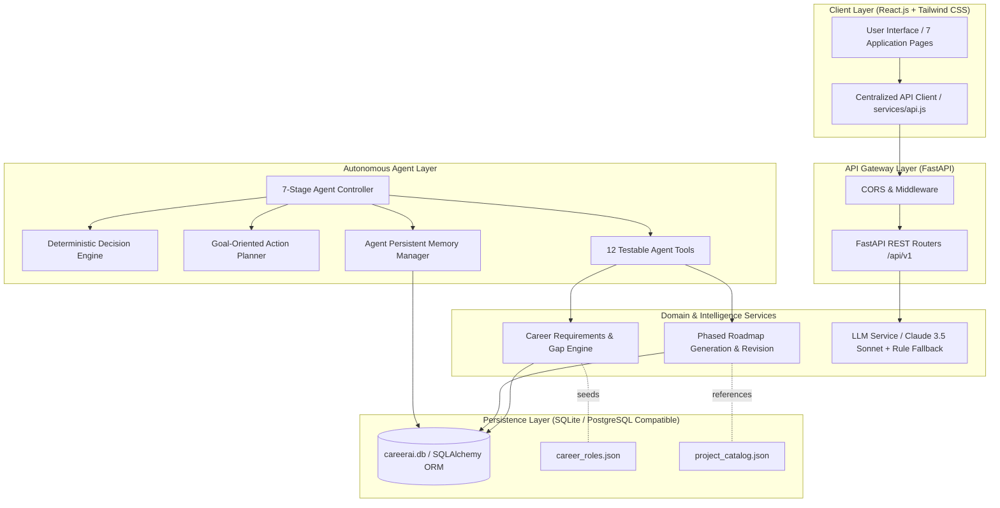
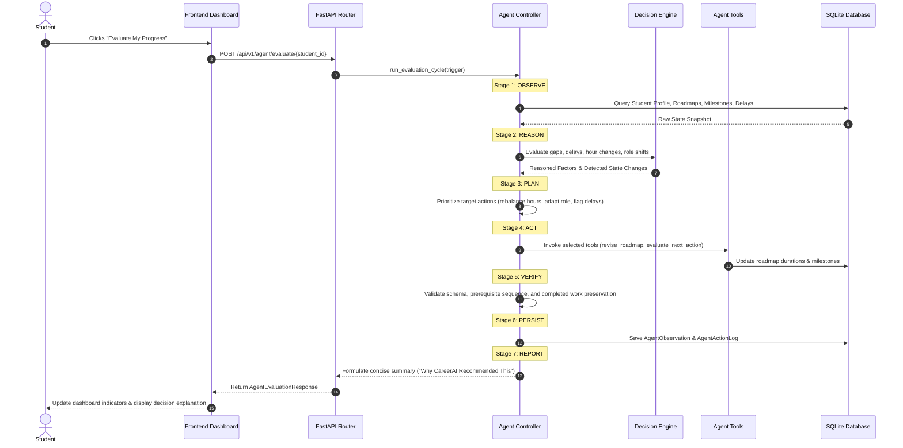
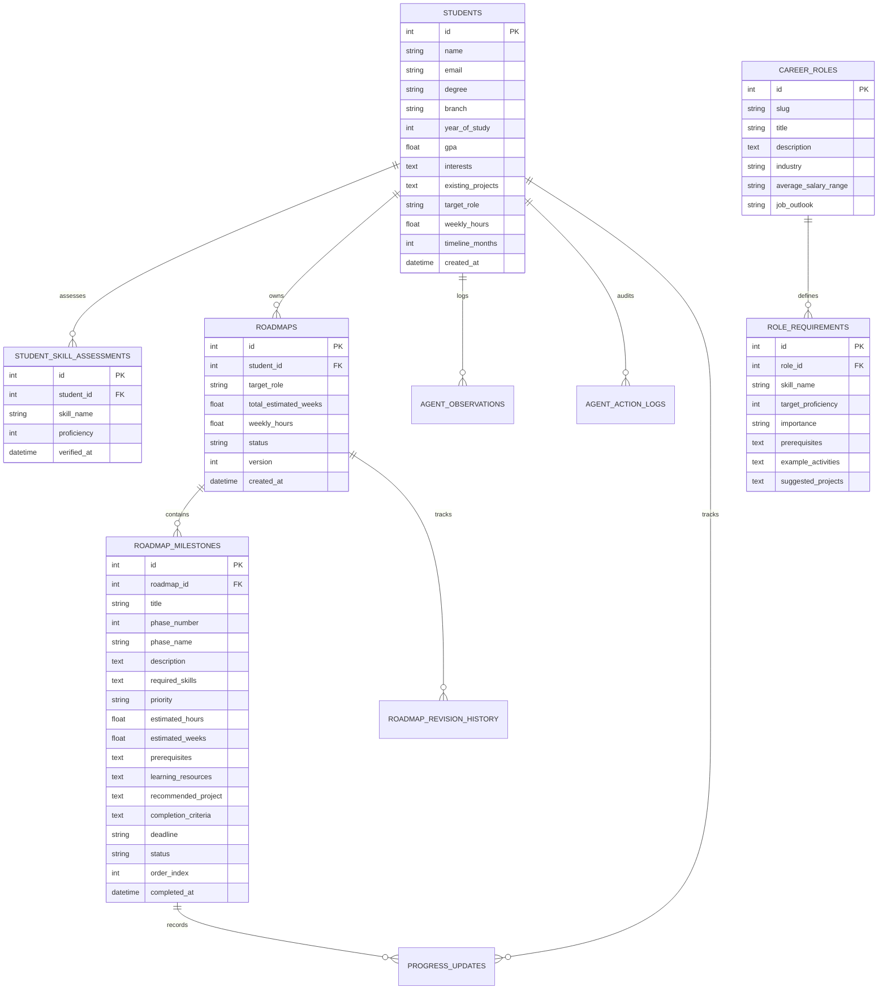

# System Architecture: CareerAI

## 1. High-Level Architectural Overview

CareerAI is designed as an autonomous, persistent, multi-layered career guidance system composed of three core tiers:
1. **Interactive Client Tier**: React.js SPA built with Vite and Tailwind CSS.
2. **Autonomous Agent & Service Tier**: FastAPI backend running Python 3.10+ with a dedicated 7-Stage Agent Controller, 12 testable agent tools, a deterministic rule engine, and an optional Claude LLM service module.
3. **Persistence & Data Tier**: Relational SQLite database accessed via SQLAlchemy ORM with foreign-key cascades, storing profiles, roadmaps, milestones, observations, and revision audit logs.

---

## 2. Data Flow & Autonomous Execution Loop

The Agent Controller coordinates seven distinct lifecycle stages during an evaluation cycle:

---

## 3. Database Schema Design (Entity-Relationship)

The relational SQLite schema maintains referential integrity through foreign keys and cascade deletes:

---

## 4. Key Architectural Decisions

1. **Deterministic Logic vs. Pure LLM**: Business rules (skill gap math, duration formulas, completed milestone preservation) are executed by deterministic Python logic rather than unconstrained prompt engineering. This eliminates arithmetic hallucinations and guarantees consistent test results.
2. **Dual Operational Modes**: By implementing a complete Rule-Based Fallback Engine, the application runs out-of-the-box in local environments without requiring paid third-party API credentials.
3. **Relational Data Integrity**: Roadmaps and milestones are stored as individual database entities with primary keys rather than serialized JSON blobs. This allows direct status updates (`PATCH /api/v1/roadmaps/milestones/{id}`) and granular audit tracking.
