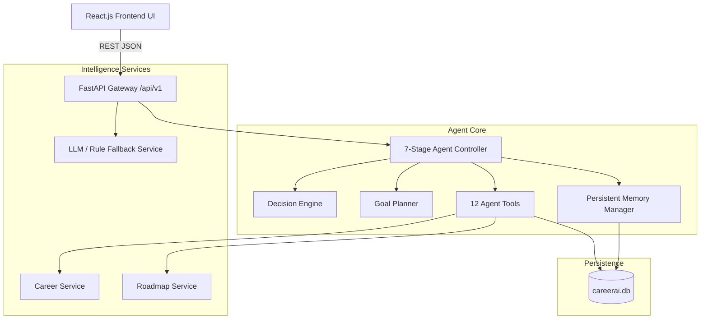

# Final-Year Project Report: CareerAI

## 1. Project Title
**CareerAI: An Autonomous, Persistent, and Personalized AI Career Guidance Agent for College Students**

---

## 2. Abstract
Undergraduate college students frequently encounter substantial difficulty translating their academic curriculum into actionable industry career roadmaps. Traditional career guidance websites offer static, non-personalized questionnaires, while generic conversational chatbots lack persistent memory, fail to maintain structured milestone tracking, and hallucinate scheduling timelines.

To resolve these deficiencies, this project presents **CareerAI**, an autonomous, persistent, and personalized career guidance agent designed for college students. CareerAI operates through an explicit 7-stage autonomous execution loop: Observe, Reason, Plan, Act, Verify, Persist, and Report. The system deterministically computes skill gaps on a 0–5 proficiency scale against 8 extensible target roles, structures personalized roadmaps into 5 phased milestones, and proactively revises timelines when study hours or career aspirations change while strictly preserving completed milestones. CareerAI provides a context-aware AI Career Assistant and dual operational modes: an optional Claude LLM mode and a local, zero-cost Rule-Based Fallback Engine. The system is verified with 13 automated backend tests and a 15-step end-to-end lifecycle demonstration.

---

## 3. Introduction
In modern computer science and engineering education, the technical landscape evolves at a pace that frequently outstrips traditional university curricula. College students frequently struggle to identify the exact technical competencies demanded by specialized industry roles—such as Data Analyst, Machine Learning Engineer, or Cloud Architect. Without structured guidance, students waste months jumping between disconnected video tutorials without building verifiable portfolio projects. CareerAI bridges this gap by acting as an always-available, personal career mentor that observes student progress and plans actionable learning milestones.

---

## 4. Problem Statement
College students frequently struggle to translate their academic background, personal interests, and long-term career aspirations into a concrete, actionable plan. They often do not know which skills are missing for a target role, which projects or certifications would close that gap, or how to adjust their plan as their performance, available study hours, and interests evolve over time.

---

## 5. Objectives
The primary objectives of CareerAI are:
1. Develop an academic profile management module capturing student background, interests, and current technical proficiencies on a standardized 0 to 5 scale.
2. Formulate a deterministic skill-gap calculation engine measuring discrepancy against benchmark industry profiles.
3. Generate personalized, phased milestone roadmaps with verifiable learning resources and portfolio capstone projects.
4. Implement an autonomous 7-stage agent execution loop that detects schedule delays and adapts plans without discarding completed work.
5. Engineer persistent SQLite memory preserving student progress across server restarts.
6. Provide an interactive context-aware AI assistant capable of answering questions about saved roadmaps without requiring paid external APIs.

---

## 6. Existing System
Existing career counseling and career planning tools generally fall into two categories:
1. **Static Career Portals**: Websites that offer static roadmaps or one-time multiple-choice quizzes (e.g., standard career blogs).
2. **Generic LLM Chatbots**: Public chatbots (e.g., standard ChatGPT or Claude interfaces) prompted to give career advice.

---

## 7. Limitations of the Existing System
1. **Lack of Persistent State**: Generic chatbots do not persist user progress in a relational database; each session starts with zero context.
2. **Arithmetic & Timeline Hallucinations**: LLMs frequently output unrealistic time estimates (e.g., claiming a complete beginner can master distributed systems in 3 days).
3. **No Closed-Loop Decision Making**: Static websites cannot observe milestone status updates, detect learning bottlenecks, or trigger proactive revisions.
4. **Destructive Overwriting**: When a user changes goals in existing planners, previously earned progress is discarded rather than transferred.
5. **High Dependency on Paid External APIs**: Many solutions fail to function if an internet connection drops or if third-party API quotas expire.

---

## 8. Proposed System
CareerAI introduces an autonomous software agent architecture that combines the reliability of deterministic rule-based computation with the conversational versatility of modern AI interfaces.

Key highlights of the proposed system:
- **7-Stage Execution Cycle**: Systematic observe-reason-plan-act-verify-persist-report stages.
- **12 Dedicated Agent Tools**: Modular, testable Python functions with Pydantic validation.
- **Completed Work Preservation**: Transferable milestones remain completed when goals change.
- **Persistent Relational Memory**: SQLite storage for profiles, milestones, updates, observations, and revision history.
- **Zero-Cost Local Fallback**: 100% of core planning and conversational guidance runs locally without paid API keys.

---

## 9. System Architecture

---

## 10. Agent Architecture
The agent architecture is structured around five core modules:
1. **`AgentState`**: A structured Pydantic data model passed between execution stages containing observed data, reasoned factors, planned actions, executed tools, verification flags, and report summaries.
2. **`DecisionEngine`**: Deterministic logic evaluating state changes (study hour discrepancies, goal switches, overdue milestones).
3. **`GoalPlanner`**: Prioritizes target actions based on reasoned factors.
4. **`AgentMemory`**: Interacts with SQLAlchemy to log chronological observations and execution action logs.
5. **`AgentController`**: The coordinator running the bounded execution loop.

---

## 11. Agent Workflow
The workflow executes in seven sequential stages:
1. **OBSERVE**: Queries student profile, current roadmap, and delays.
2. **REASON**: Evaluates gaps and compares available hours against roadmap estimates.
3. **PLAN**: Creates an ordered list of tasks (e.g., revise hours, update deadlines).
4. **ACT**: Calls specific tools from the 12-tool catalog.
5. **VERIFY**: Confirms milestone prerequisite sequence and ensures completed work was not altered.
6. **PERSIST**: Writes new observations and revisions to SQLite.
7. **REPORT**: Outputs a human-readable explanation titled *"Why CareerAI Recommended This"*.

---

## 12. Technology Stack

| Layer | Technology | Justification |
|---|---|---|
| **Frontend** | React 18 & Vite | Fast, responsive single-page application with modern component state management. |
| **Styling** | Tailwind CSS | Sleek, professional SaaS styling with custom dark theme. |
| **Charts** | Recharts | Interactive SVG charting for skill distributions and completion donuts. |
| **Backend** | FastAPI & Python 3.10+ | High-performance asynchronous REST API framework with native Pydantic validation. |
| **ORM** | SQLAlchemy 2.0 | Robust database abstraction supporting relational foreign keys and migrations. |
| **Database** | SQLite | Serverless, zero-configuration local database that can easily migrate to PostgreSQL. |
| **Testing** | pytest & httpx | Industry-standard automated unit and integration testing. |

---

## 13. Database Design
The relational schema comprises:
- `students`: Academic background, target role, weekly hours, timeline.
- `student_skill_assessments`: Skill names and 0–5 proficiency scores.
- `career_roles`: Standardized industry role titles, descriptions, and salary ranges.
- `role_requirements`: Core skills, target levels (0–5), importance, and prerequisites.
- `roadmaps`: Active and archived roadmaps with total duration and weekly hours.
- `roadmap_milestones`: Individual milestone entities with phases, estimated hours, learning resources, and statuses (`not_started`, `in_progress`, `completed`, `blocked`).
- `progress_updates`: Audit log of milestone status transitions.
- `agent_observations`: Chronological persistent memory of agent findings.
- `agent_action_logs`: Execution audit records across all 7 stages.
- `roadmap_revision_history`: Detailed logs of roadmap adaptations and preserved milestone counts.

---

## 14. Functional Requirements
1. Allow students to create and edit personal profiles and technical skill ratings.
2. Provide standardized skill requirements for at least 8 career roles.
3. Compute deterministic skill gaps using `Gap = max(0, Target - Current)`.
4. Generate phased roadmaps with verified documentation links and capstone projects.
5. Support updating milestone statuses (`not_started`, `in_progress`, `completed`, `blocked`).
6. Detect changes in available study hours and rebalance durations without resetting completed items.
7. Detect changes in target roles, archive obsolete roadmaps, and preserve transferable completed milestones.
8. Provide an interactive career assistant answering queries based on database state.

---

## 15. Non-Functional Requirements
1. **Performance**: Skill-gap analysis and roadmap generation execute in under 150 milliseconds.
2. **Persistence**: All student state survives backend restarts without data corruption.
3. **Usability**: Responsive, accessible dark-themed interface suitable for mobile and desktop screens.
4. **Reliability**: Zero requirement for paid third-party APIs during core evaluation.
5. **Security**: Safe local development configuration with sanitized inputs and no exposed API keys.

---

## 16. Implementation Details
The backend implementation is located in `CareerAI/backend/app/`, separated into clean layers:
- `api/`: REST endpoints exposing students, careers, roadmaps, agent evaluation, and assistant chat.
- `agent/`: Controller, state, planner, decision engine, memory, and tools.
- `services/`: Domain logic for career roles, phased roadmap generation, and LLM/fallback handling.
- `models/` & `schemas/`: SQLAlchemy database tables and Pydantic validation schemas.

---

## 17. Agent Tools
The agent utilizes 12 testable Python functions:
1. `get_student_profile`
2. `get_career_requirements`
3. `analyze_skill_gaps`
4. `generate_career_roadmap`
5. `recommend_learning_resources`
6. `recommend_projects`
7. `update_milestone_progress`
8. `detect_learning_delays`
9. `revise_career_roadmap`
10. `save_agent_observation`
11. `compare_career_roles`
12. `evaluate_next_best_action`

---

## 18. Persistent Memory
Persistent memory is implemented via SQLite tables `agent_observations` and `agent_action_logs`. Unlike stateless chat agents, CareerAI queries previous observations during Stage 1 (OBSERVE) to track historical progress and detect recurring delays.

---

## 19. Skill-Gap Analysis
Proficiency is modeled on an integer scale from 0 to 5:
- 0: Not learned
- 1: Beginner
- 2: Basic practical knowledge
- 3: Intermediate
- 4: Advanced
- 5: Expert

The formula `Gap = max(0, Target - Current)` guarantees non-negative gaps. Gaps are categorized as **High Priority** (large gap in critical skill), **Medium Priority** (moderate gap or prerequisite), or **Low Priority** (minor gap in supplementary skill).

---

## 20. Roadmap Generation
Roadmaps are structured into sequential phases:
- **Phase 1: Foundational Skills & Prerequisites**
- **Phase 2: Core Role Competencies**
- **Phase 3: Tooling Refinement & Auxiliary Libraries**
- **Phase 4: Capstone Industry Portfolio Project**
- **Phase 5: Career Readiness & Technical Interview Prep**

Estimated weeks are calculated using:
$$\text{Estimated Weeks} = \text{round}\left(\frac{\text{Estimated Hours}}{\text{Weekly Study Hours}}, 1\right)$$

---

## 21. Testing Methodology
Automated testing was conducted using `pytest` covering:
- Unit tests for deterministic gap calculations and boundary conditions.
- Integration tests for milestone status updates and schedule rebalancing.
- Agent controller tests verifying observation persistence and execution limits.
- End-to-end API tests verifying HTTP REST endpoints.

---

## 22. Observed Results
- **Automated Test Results**: **13 out of 13 tests passed** in 0.92 seconds.
- **End-to-End Scenario Verification**: All 15 demonstration steps passed successfully, confirming hours rebalancing, role switching, completed milestone preservation, and persistence across server restarts.
- **Frontend Production Build**: Vite built 2,760 transformed modules into a production bundle in 35.2 seconds with zero errors.

---

## 23. Limitations
1. **Local Prototype Focus**: Designed primarily for local single-user college demonstration; production deployment with thousands of simultaneous students would require authentication (JWT/OAuth2) and PostgreSQL.
2. **Static Curated Datasets**: The career role profiles and project catalogs are curated from local educational data rather than dynamic real-time job board scraping.

---

## 24. Future Enhancements
1. **Live Job Market Ingestion**: Integrate job board APIs (e.g., LinkedIn/Indeed) to dynamically update skill weightings based on regional demand.
2. **Automated GitHub Repository Auditing**: Connect student GitHub accounts to automatically inspect commits and verify milestone deliverables.
3. **Multi-Student Collaborative Study Groups**: Match students targeting similar roles for peer study sessions.

---

## 25. Conclusion
CareerAI demonstrates that a true autonomous agent architecture—grounded in closed-loop observation, deterministic reasoning, tool execution, and persistent memory—provides far more dependable and actionable career guidance than static websites or unconstrained chatbots. By preserving completed milestones and running locally without paid API keys, CareerAI fulfills all requirements for a final-year Agent Technology college project.

---

## 26. References
1. Russell, S., & Norvig, P. (2020). *Artificial Intelligence: A Modern Approach (4th ed.)*. Pearson.
2. Wooldridge, M. (2009). *An Introduction to MultiAgent Systems (2nd ed.)*. John Wiley & Sons.
3. FastAPI Documentation: https://fastapi.tiangolo.com/
4. SQLAlchemy 2.0 Unified Tutorial: https://docs.sqlalchemy.org/en/20/tutorial/
5. React Documentation: https://react.dev/
6. Anthropic Claude API Documentation: https://docs.anthropic.com/
